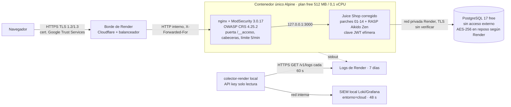

# Despliegue cloud real — Render (capa gratuita) · 2026-11-24

**Estado:** desplegado y verificado. **URL (acceso restringido):** `https://juice-lab-masi-staging.onrender.com`.
**Costo:** US$0 (plan free, sin tarjeta). **Evidencia:** `evidence/cierre-brechas-2026-11-24/` (vigente) y
`evidence/cierre-tecnico-2026-11-23/13-cloud/` (primeras versiones).
**Código:** rama `main` (Blueprint sincronizado desde `main`); `render.yaml`; imagen `deploy/cloud/Dockerfile`.
**Versión desplegada (vigente; despliegue `dep-dc37ad15efls73b26ms0`, 2026-11-25 UTC):** commit `768d1da` — imagen **Alpine** (WAF CRS 4.25.2 + app compilada
para musl), parches 01-14, exclusión EX-2 (socket.io). Puerta de release **APTA** (Trivy C1 exceptuada / H0) en local y en CI.
Revalidada en la nube: puerta 28/28, regresión 15/15, recorrido 35/35, A1-A12 / BOLA / T1-T10 sin vulnerables, TLS 1.2/1.3,
socket.io 200, 0 secretos en los logs (`evidence/cierre-brechas-2026-11-24/10-validacion-render/`).
Versiones anteriores: `0be0b5f` (Debian, `13-cloud/render-0be0b5f/`) y `39487a3` (`13-cloud/render/`).

## 1. Por qué Render
| Plataforma | Resultado | Motivo |
|---|---|---|
| Seenode | Descartada por el equipo | — (plan conservado en `PLAN_DESPLIEGUE_SEENODE.md`) |
| DigitalOcean App Platform | No desplegada | La cuenta no tiene método de pago (requisito para el primer recurso); su único crédito (US$5) es de inferencia; los contenedores cuestan desde US$5/mes. `.do/app.yaml` queda listo |
| **Render** | **Desplegada** | Servicio web Docker y PostgreSQL gratis, sin tarjeta (D-18) |

## 2. Arquitectura DESPLEGADA (real, verificada)

El **diseño objetivo** (CDN + WAF gestionado + API Gateway + IAM + BD privada cifrada) sigue en `PLAN_DESPLIEGUE_SEENODE.md` §3
y en `infra/terraform/` (AWS, solo `plan`). Lo desplegado no lo sustituye: se indica abajo qué cubre y qué no.

## 3. Controles verificados en la nube
| Control | Verificación | Resultado |
|---|---|---|
| Fuente = código auditado | Log de construcción de Render | `ok fuente = diff auditado (fc3f765c…), 22 archivos` (parches 01-14) |
| Imagen conforme a la política | Puerta de release local y en CI | APTA: Trivy CRITICAL 1 (marsdb, exceptuada) / HIGH 0 |
| XSS | Navegador real (Chromium), 6 vectores | 0/6 en la imagen cloud (local); la oficial sin modo seguro, 5/6 |
| TLS | Handshakes reales con OpenSSL 3.5.7 | 1.0/1.1 rechazadas; 1.2 (ECDHE-ECDSA-AES128-GCM) y 1.3 (TLS_AES_256_GCM_SHA384) aceptadas; HTTP → 301; HSTS |
| Acceso restringido | Puerta propia | Sin cookie → 302; 401 sin cookie; cookie de 256 bits `Secure; HttpOnly; SameSite`; falsificada → 302 |
| Fuerza bruta | 7 intentos | 429 desde el 5.º, también con `X-Forwarded-For` falsificado |
| WAF (OWASP Top 10) | A1-A12, T1-T10 | 0 vulnerables; SQLi, NoSQL, SSRF/RFI y RCE bloqueados (reglas 942, 931/934, 932) |
| Autorización (BOLA) | 5 tipos de objeto | 0/10 accesos ajenos; 7/7 controles positivos |
| Funcionalidad | Regresión y recorrido | 15/15 y 35/35, 0 falsos positivos |
| Secretos | Logs de Render | 0 JWT, 0 cookies, 0 `Authorization`; clave JWT generada dentro del contenedor |
| BD administrada | `DATABASE_URL` de Render | La app usa PostgreSQL (parche 13); `ipAllowList: []` (sin acceso externo) |
| SIEM | Eventos cloud en Loki | Ingesta AUTOMÁTICA y autenticada (colector + API de Render): 48 s extremo a extremo, 0 secretos; T5/T7 verificados desde el SIEM |
| Funcionalidad en tiempo real | socket.io (POST text/plain) | 200 tras EX-2 (antes 403 por la regla 920420) |

## 4. Puerta de release sobre la imagen cloud (hallazgo del 2026-11-24)
La puerta (`scripts/pipeline-release.sh`, política `security/release/politica-release.json`) solo se había aplicado a la imagen de
la app (distroless). Aplicada a la imagen cloud (`13-cloud/release-imagen-cloud/`):

| | Primera imagen desplegada | Tras corregir (base 202611190211 + parches Debian + `.dockerignore` de Juice Shop) |
|---|---|---|
| Trivy CRITICAL / HIGH | 3 / 135 | 2 / 76 (CRITICAL: `marsdb`, exceptuada, y `libxml2` CVE-2026-6653 sin corrección) |
| Secretos en la imagen | 1 (clave de ejemplo de `terraform/`) | 0 |
| Hadolint / Gitleaks | 0 / 1 (falso positivo revisado) | 0 / 0 (huella en `.gitleaksignore`) |
| **Veredicto** | — | **BLOQUEADA**: 75 HIGH y 1 CRITICAL **sin corrección publicada**, todos paquetes de Debian de la imagen base del WAF (`owasp/modsecurity-crs`: libxml2, expat, util-linux, perl, curl, ncurses, x11, sqlite…) |

Consecuencias: (1) la imagen cloud **no cumple** la política de release y su publicación se sostiene solo como demostración con
acceso restringido; (2) el mismo origen afecta al contenedor del WAF del stack local, que nunca pasó por la puerta. Tratamiento
que debe decidir el equipo (ISO/IEC 27005): **aceptar** temporalmente con excepciones fechadas (como libssl), **reducir** con otra
base de WAF o retirando paquetes no usados, o **evitar** separando WAF y app (requiere un segundo servicio, con costo).
No se añadieron excepciones: aceptar el riesgo no es una decisión técnica.

**Resolución (2026-11-24, D-22):** se eligió **reducir**: la misma versión del WAF en su variante **Alpine** y la app compilada
para musl. Resultado: **APTA** (Trivy CRITICAL 1 exceptuada / HIGH 0), en local y en CI, sin excepciones nuevas ni umbrales
cambiados. Detalle y residual en `TRATAMIENTO_RIESGO_IMAGEN_CLOUD.md`. El WAF local pasó a la misma base.

## 5. Límites y riesgos residuales del despliegue
- **Sin CDN con caché ni WAF gestionado propios:** hay Cloudflare delante (lo revela la cabecera `Server`), pero lo gestiona
  Render; el WAF efectivo es el nuestro. **Sin API Gateway** de producto: nginx hace enrutamiento, autenticación y límites.
- **WAF y app en el mismo contenedor** (un solo servicio gratuito): la app no tiene puerto publicado, pero no hay aislamiento
  de red entre ambos.
- **TLS hacia la BD sin verificar el certificado** (Render solo admite `require` en la red privada).
- **Plan free:** se suspende tras 15 min sin tráfico (~1 min al despertar más ~70 s de arranque de Juice Shop); al reiniciar,
  Juice Shop resiembra su BD y la clave JWT cambia (las sesiones caducan). La **BD free vence a los 30 días** (2026-12-24) y
  Render la borra 14 días después.
- **SIEM cloud continuo, pero desde el equipo local:** el colector (`make colector-render`) solo trae eventos mientras el stack
  local está encendido; Render conserva 7 días, así que al volver a encenderlo recupera lo pendiente. Un servicio 24/7 tendría costo.
- La variante sigue siendo una app de entrenamiento con retos no auditados: por eso el acceso es restringido y la URL no se anuncia.

## 6. Operación
- **Usuarios de la puerta:** variable `BASIC_AUTH_HTPASSWD` del servicio (Environment). Entradas `usuario:hash-bcrypt`
  separadas por espacios; generar cada una en el equipo con
  `docker run --rm -it httpd:2.4-alpine htpasswd -nB -C 10 <usuario>`. El arranque informa qué usuarios cargó, nunca hashes.
  Hoy solo está `verificador` (la entrada `equipo` no llegó a guardarse en la variable).
- **Redesplegar:** *Manual Deploy → Deploy latest commit* (el despliegue automático está desactivado); los cambios de
  `render.yaml` se aplican con *Blueprint → Manual sync → Approve*.
- **Verificar:** `HOST_CLOUD_AUTORIZADO=juice-lab-masi-staging.onrender.com CHK_XFF=1 SSRF_DESTINO=http://127.0.0.1:8080
  bash security/ops/validar-cloud.sh https://juice-lab-masi-staging.onrender.com <archivo usuario:contraseña> <salida>` y
  `security/ops/tls-cloud.sh`.
- **Apagar sin borrar:** servicio → *Settings → Suspend Web Service*. **Eliminar:** borrar el servicio y la BD (irreversible;
  solo con decisión del equipo).
