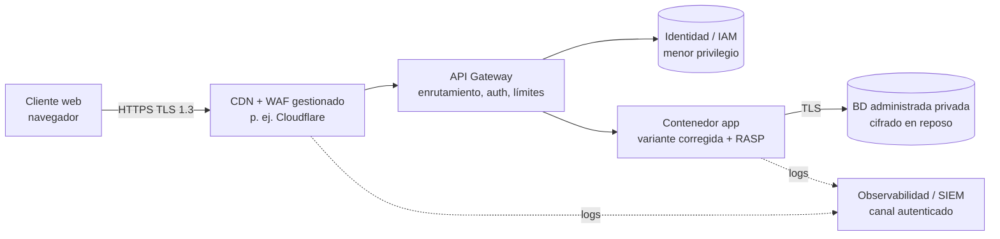

# Plan de despliegue cloud en Seenode (hito C) — preparado, NO desplegado

**Fecha:** 2026-11-23. **Estado:** no se ha conectado ninguna cuenta ni creado ningún recurso. El reloj de la prueba de
Seenode empieza al crear la primera aplicación o base de datos, por eso no se inicia hasta decidir el plan.

## 1. Lo que Seenode ofrece (documentación oficial leída el 2026-11-23)
Fuentes: `seenode.com/docs/reference/pricing` (actualizada 2026-11-15), `/docs/services/docker-image`, `/docs/networking/*`,
`/docs/configure/environment-variables`, `/docs/data/databases`, `/docs/data/databases/backups`, `/docs/api/mcp`.

| Tema | Dato documentado | Consecuencia |
|---|---|---|
| Prueba | 7 días, sin tarjeta; **1 aplicación Basic + 1 BD Basic**; empieza al crear el primer recurso | Solo dos recursos sin costo |
| Aplicación Basic | 0,5 GB RAM, 0,25 vCPU ($4/mes tras la prueba) | **Medido:** la app con RASP y PostgreSQL usa 145 MiB pico con esos límites |
| BD administrada | PostgreSQL o MySQL; Basic 1 GB, 20 conexiones, 7 copias diarias | El parche 13 permite usarla de verdad |
| Despliegue | Desde GitHub/GitLab (requiere **push**) o imagen de Docker Hub/GHCR/registro propio (Beta, `linux/amd64`) | Ambas rutas publican algo: necesitan tu autorización |
| HTTPS | Let's Encrypt automático en `*.seenode.app`; versión de TLS **no indicada** | Se mide con un handshake real tras desplegar |
| Red privada | Servicios web y privados en `http://{nombre}-service`; BD accesible por red privada o pública | Hay que verificar que la BD no quede pública |
| Secretos | Variables de entorno; los valores secretos se cifran en reposo | Clave JWT y `DATABASE_URL` como secretos |
| Cifrado en reposo de BD/discos | **No indicado** (solo secretos) | No se puede afirmar AES-256 sin evidencia del proveedor |
| CDN, WAF, API Gateway, DDoS | **No ofrecidos** | El WAF es el nuestro (ModSecurity) |
| Restricción por IP o autenticación básica | **No indicadas** | El acceso restringido lo daría nuestro WAF |
| Logs | Pestaña Logs, hasta 14 días; sin exportación documentada | El SIEM híbrido necesita otra vía (punto 5) |
| MCP | `https://mcp.seenode.com/mcp`, OAuth 2.1 + PKCE, más de 70 herramientas, sin herramientas de borrado | La conexión la autoriza el usuario con `/mcp` |
| Región | Frankfurt | — |

## 2. Criterio de autorización de publicación (aplicado a la variante final)
| Criterio | Estado | Evidencia |
|---|---|---|
| Artefacto actualizado y escaneado | Cumple | `evidence/cierre-tecnico-2026-11-23/08-pipeline-release/puerta-release.md` (APTA) |
| Sin hallazgos críticos explotables en el alcance publicado | **Parcial** | 1 CRITICAL sin corrección (`marsdb`, vía `$where` eliminada). Juice Shop conserva decenas de retos no auditados en este proyecto (p. ej. su tablero de retos, otros XSS del frontend) |
| Controles de acceso efectivos | Cumple en lo probado | BOLA 0/10, CSRF, JWT, quejas y reciclajes (`06-regresion/artefacto-final/`) |
| Sin exposición de servicios internos | Cumple en local | Solo el WAF publica puerto; BD, SIEM y app en redes internas |

**Dictamen:** la variante final **no es apta para exposición pública abierta**, porque sigue siendo una aplicación de
entrenamiento con vulnerabilidades no auditadas. **Sí es apta para una demostración temporal con acceso restringido**
(autenticación en el WAF, datos sintéticos, URL no anunciada), como exige `CLAUDE.md` (*la versión endurecida solo por túnel
o con acceso restringido*).

## 3. Arquitectura objetivo (DISEÑO, no desplegada)

Equivale al diseño AWS de la Fase 2 (`infra/terraform/`: ALB TLS 1.3, WAFv2, KMS), que se mantiene como diseño y no se aplica.

## 4. Opciones de despliegue en Seenode (propuestas, sin ejecutar)
| Opción | Componentes | Costo | Cumple | No cumple / limita |
|---|---|---|---|---|
| **A. Dentro de la prueba** | 1 servicio web = un contenedor con Nginx + ModSecurity/CRS (autenticación básica, límite de tasa, cabeceras) + la app con RASP; 1 PostgreSQL Basic privado (parche 13) | $0 durante 7 días | Contenedor, BD administrada real, HTTPS del proveedor, WAF propio, secretos | Sin CDN ni API Gateway de producto (Nginx cubre enrutamiento, autenticación y límites, y así se documenta, sin llamarlo «gateway»); WAF y app en el mismo contenedor |
| **B. Aislamiento real** | Servicio web WAF + servicio **privado** con la app + PostgreSQL | +$4/mes por el segundo servicio (fuera de la prueba) | Igual que A, con la app sin exposición directa | Requiere aprobar el costo |
| **C. CDN/WAF gestionado** | A o B + Cloudflare delante | Dominio propio (compra) | CDN real y WAF gestionado | Requiere comprar un dominio y crear otra cuenta |
| **D. Cambio de plataforma** | WooCommerce/WordPress + MySQL administrado | Igual que A | Opción B de la consigna, literal | Hay que repetir sobre ella los controles y pruebas de las seis fases; requiere tu aprobación |

**Recomendación técnica:** la opción A con acceso restringido es la única sin costo que despliega contenedor, BD administrada
y HTTPS de forma real. Antes de crear recursos hace falta construir y probar en local la imagen combinada (WAF + app), con los
límites de Basic.

## 5. SIEM en el escenario cloud
No se abrirán Loki ni Grafana locales a Internet. Seenode no documenta exportación de logs, así que quedan dos vías:
(1) lectura periódica de los logs del servicio mediante el MCP/API de Seenode e ingestión local con la etiqueta
`entorno="cloud"` (el panel ya filtra por `entorno`), o (2) un servicio de observabilidad externo con canal autenticado
(nueva cuenta: requiere aprobación). Los logs locales nunca se presentarán como cloud.

## 6. Lo que necesitas hacer o decidir (bloqueos)
1. **Elegir la opción** (A, B, C o D) y aceptar el acceso restringido de la demostración.
2. **Autorizar la ruta de publicación del artefacto:** push de una rama a GitHub (Seenode la construye) o publicar la imagen en
   GHCR/Docker Hub de forma privada (necesita credenciales que configuras tú).
3. **Conectar Seenode:** en una terminal, `claude mcp add --scope user --transport http seenode https://mcp.seenode.com/mcp` y luego
   `/mcp` para completar OAuth en el navegador. No escribas credenciales en el chat.
4. **Confirmar el inicio de la prueba de 7 días** (empieza al crear el primer recurso) y que no se activará ningún pago.
5. Para la opción D, **confirmar con el docente** si Juice Shop es aceptable como plataforma (no hay constancia de esa aceptación).
