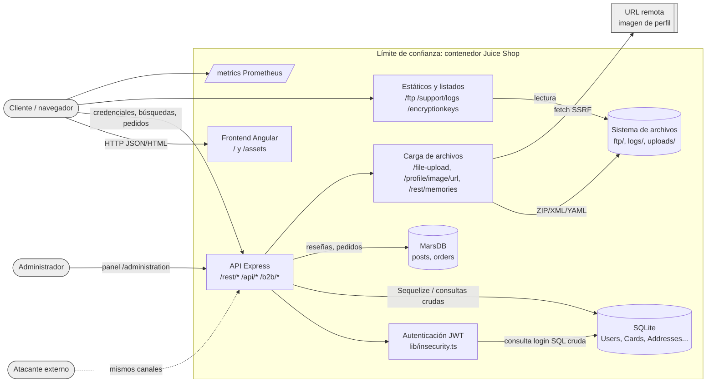

# Fase 1 – Inventario de activos, DFD y modelado de amenazas (OWASP Juice Shop v20.3.0)

**Estado:** Implementado y verificado (revisión del código fuente fijado en `app/`, commit `f189f521`).
La metodología (CIA, DREAD, siete capas) se hereda del caso Kakaw Store; **ningún dato de Kakaw se reutiliza**.
Cada referencia `archivo:línea` apunta a `app/` y puede verificarse en el submódulo.

> Etiquetas: **[V]** implementado y verificado · **[S]** simulado · **[P]** propuesto.
> La valoración DREAD de esta fase es *a priori* (desde el código). El riesgo **inherente medido** se obtiene
> en la Fase 4 con ataques reales contra el laboratorio (127.0.0.1) y el **residual** en la Fase 6.

## 1. Alcance y sistema
| Elemento | Valor (evidencia) |
|---|---|
| Aplicación | OWASP Juice Shop 20.3.0, imagen `bkimminich/juice-shop:v20.3.0@sha256:cea5a4af…` |
| Backend | Node.js 24 (distroless), Express 4, `server.ts` (822 líneas, 109 rutas `app.get/post/put/patch/delete`) |
| Frontend | Angular (SPA), servido por Express |
| Datos relacionales | SQLite vía Sequelize: `data/juiceshop.sqlite` (`models/index.ts:34-41`) |
| Datos documentales | MarsDB en memoria: colecciones `posts` (reseñas) y `orders` (`data/mongodb.ts:9-10`) |
| API REST automática | `finale.resource` sobre 14 modelos (`server.ts:511-528`) |
| Autenticación | JWT RS256 firmado con clave privada embebida (`lib/insecurity.ts:21,54`) |
| Laboratorio | `deploy/lab/docker-compose.yml`, publicado solo en `127.0.0.1:3000` (evidence/fase-1/lab-puertos.txt) |

## 2. Inventario de activos y valoración CIA
Escala: Alta=3, Media=2, Baja=1. Criticidad = C+I+D (9 crítica · 7-8 alta · 5-6 media · 3-4 baja).

| ID | Activo | Ubicación en el código | C | I | D | Total | Criticidad |
|---|---|---|---|---|---|---|---|
| A01 | Credenciales de usuario (email, hash de contraseña MD5, `totpSecret`) | `models/user.ts`; hash en `lib/insecurity.ts:41` | 3 | 3 | 2 | 8 | Alta |
| A02 | Clave privada JWT y tokens de sesión | `lib/insecurity.ts:21,54`; `encryptionkeys/` | 3 | 3 | 2 | 8 | Alta |
| A03 | Datos de tarjetas de pago (`fullName`, `cardNum`, `expMonth/Year`) | `models/card.ts` | 3 | 3 | 1 | 7 | Alta |
| A04 | PII: direcciones, teléfono, email, `lastLoginIp`, imagen de perfil | `models/address.ts`, `models/user.ts` | 3 | 2 | 1 | 6 | Media |
| A05 | Respuestas de seguridad (recuperación de cuenta) | `models/securityAnswer.ts` | 3 | 3 | 1 | 7 | Alta |
| A06 | Monedero (saldo) y cupones | `models/wallet.ts`, `models/basket.ts` (`coupon`) | 2 | 3 | 2 | 7 | Alta |
| A07 | Pedidos y carritos | MarsDB `orders`; `models/basket.ts`, `basketitem.ts` | 2 | 3 | 2 | 7 | Alta |
| A08 | Reseñas, feedback, quejas (con archivo), memorias (imágenes) | MarsDB `posts`; `models/feedback.ts`, `complaint.ts`, `memory.ts` | 1 | 2 | 1 | 4 | Baja |
| A09 | Catálogo de productos y precios | `models/product.ts`, `models/delivery.ts` | 1 | 3 | 3 | 7 | Alta |
| A10 | Documentos internos expuestos en `/ftp` | `ftp/`; `server.ts:290` | 3 | 1 | 1 | 5 | Media |
| A11 | Registros de acceso | `logs/`; `server.ts:302-304` (`/support/logs`) | 2 | 3 | 2 | 7 | Alta |
| A12 | Métricas Prometheus | `/metrics`, `server.ts:704,759` | 2 | 1 | 1 | 4 | Baja |
| A13 | Código y configuración (`config/*.yml`, `ctf.key`) | raíz de `app/` | 2 | 3 | 1 | 6 | Media |
| A14 | Contenedor/host de ejecución | `app/Dockerfile` (distroless, usuario 65532) | 2 | 3 | 3 | 8 | Alta |
| A15 | Pipeline CI/CD y dependencias (supply chain) | `.github/workflows/devsecops.yml`, `package.json` | 2 | 3 | 2 | 7 | Alta |
| A16 | Disponibilidad del servicio web (tienda) | Express `server.ts:768-773` | 1 | 2 | 3 | 6 | Media |

## 3. Diagrama de flujo de datos (DFD nivel 1)
**[V]** Derivado del código. **[P]** Versión en OWASP Threat Dragon (`docs/fase-1/dfd-juice-shop.json`) pendiente de dibujo por el
equipo (Threat Dragon está instalado en el equipo; la herramienta es gráfica).

Límites de confianza: (TB0) Internet ↔ contenedor; (TB1) proceso Node ↔ almacenamiento (SQLite, archivos);
(TB2) proceso ↔ recursos remotos (carga de imagen por URL, `routes/profileImageUrlUpload.ts`).

## 4. STRIDE por elemento del DFD
| ID | Elemento | STRIDE | Amenaza | Evidencia en código | OWASP Top 10:2025 / CWE |
|---|---|---|---|---|---|
| T01 | Login | S, E | Inyección SQL en el login permite autenticarse como cualquier usuario (incl. admin) | `routes/login.ts:34` (template literal con `req.body.email`) | A05 Injection / CWE-89 |
| T02 | Búsqueda | I | Inyección SQL UNION en búsqueda extrae tablas completas (Users, Cards) | `routes/search.ts:23` | A05 / CWE-89 |
| T03 | AUTH | S | Clave privada RSA embebida: cualquiera con el código forja JWT válidos | `lib/insecurity.ts:21,54` | A04 Cryptographic Failures / CWE-798 |
| T04 | AUTH | S | Bibliotecas JWT obsoletas (`jsonwebtoken` 0.4.0, `express-jwt` 0.1.3) aceptan algoritmos débiles/`none` | `package.json`; npm audit (Fase 3) | A03 Supply Chain / CWE-347 |
| T05 | SQL Users | I | Contraseñas con MD5 sin sal → descifrado trivial tras fuga | `lib/insecurity.ts:41` | A04 / CWE-916 |
| T06 | API REST automática | I, T | Recursos `finale` sin control por propietario (IDOR) en Addresses/Cards/Baskets/Feedbacks | `server.ts:511-528`, `:427,631` | A01 Broken Access Control / CWE-639 |
| T07 | API `/api/Users` | E | Registro permite fijar `role: admin` (asignación masiva) | `server.ts:436-448` | A01 / CWE-915 |
| T08 | Reseñas (MarsDB) | T | Inyección NoSQL en actualización de reseñas (`$ne`, operadores) | `server.ts:662`; `routes/updateProductReviews.ts` | A05 / CWE-943 |
| T09 | B2B / perfil / captcha | E | Ejecución de código: `eval()` y `vm.runInContext` sobre datos del usuario | `routes/userProfile.ts:65`, `routes/b2bOrder.ts:23`, `routes/captcha.ts:22`, `routes/fileUpload.ts:114` | A05 / CWE-95 |
| T10 | Carga XML | I | XXE: parser XML con entidades externas lee archivos locales | `lib/xml.ts`, `routes/fileUpload.ts` (`handleXmlUpload`) | A02 Misconfiguration / CWE-611 |
| T11 | Imagen por URL | I, E | SSRF: el servidor descarga URLs arbitrarias | `server.ts:339`; `routes/profileImageUrlUpload.ts` | A01 / CWE-918 |
| T12 | Estáticos | I | Listado de directorios en `/ftp`, `/support/logs`, `/encryptionkeys` | `server.ts:290,298,302` | A02 / CWE-548 |
| T13 | Frontend | T, I | XSS persistente/reflejado (sin `xssFilter`, CSP débil con `unsafe-eval`) | `server.ts:189`; `routes/userProfile.ts:91` | A05 / CWE-79 |
| T14 | API | I | CORS `*` permite lectura cross-origin | `server.ts:183-184` | A02 / CWE-942 |
| T15 | Redirección | S | Open redirect con lista blanca evadible (`includes`) | `server.ts:687`; `lib/insecurity.ts:133` | A01 / CWE-601 |
| T16 | Login / reset | S | Fuerza bruta: sin límite de intentos en `/rest/user/login` (solo en reset) | `server.ts:371` vs `:624` | A07 Authentication Failures / CWE-307 |
| T17 | Métricas | I | `/metrics` expuesto sin autenticación | `server.ts:759` | A02 / CWE-200 |
| T18 | Proceso Node | D | Expresiones `vm` y uploads ZIP pueden agotar CPU/memoria (timeout 2 s, límite 200 kB) | `routes/b2bOrder.ts:23`, `server.ts:722` | A10 Exceptional Conditions / CWE-400 |
| T19 | Registro | R | Logs de acceso sin integridad ni centralización; sin alertas | `server.ts:302-304` | A09 Logging & Alerting Failures / CWE-778 |
| T20 | Supply chain | T | Dependencias con CVE críticas (marsdb, lodash 2.4.2, crypto-js 3.3.0, tar) | Fase 3: `evidence/fase-3/sca/` | A03 / CWE-1395 |

## 5. Valoración DREAD (a priori)
Rúbrica (1-10): **D**año (1 molestia · 5 datos de un usuario · 10 compromiso total/datos de todos);
**R**eproducibilidad (1 raro · 10 siempre); **E**xplotabilidad (1 experto+condiciones · 5 herramienta pública · 10 navegador);
**A**fectados (1 un usuario · 5 algunos · 10 todos); **D**escubribilidad (1 oculto · 5 requiere análisis · 10 público/evidente).
Riesgo = promedio: ≥8 crítico · 6-7.9 alto · 4-5.9 medio · <4 bajo.

| ID | Amenaza | D | R | E | A | D | Riesgo | Nivel |
|---|---|---|---|---|---|---|---|---|
| T01 | SQLi login | 10 | 10 | 9 | 10 | 9 | 9.6 | Crítico |
| T02 | SQLi UNION búsqueda | 10 | 10 | 7 | 10 | 8 | 9.0 | Crítico |
| T03 | Clave JWT embebida | 10 | 10 | 6 | 10 | 7 | 8.6 | Crítico |
| T06 | IDOR API REST | 7 | 10 | 8 | 8 | 8 | 8.2 | Crítico |
| T09 | eval / RCE | 10 | 8 | 5 | 10 | 5 | 7.6 | Alto |
| T07 | Registro como admin | 8 | 10 | 7 | 5 | 6 | 7.2 | Alto |
| T05 | MD5 sin sal | 8 | 10 | 6 | 10 | 5 | 7.8 | Alto |
| T10 | XXE | 8 | 8 | 5 | 10 | 5 | 7.2 | Alto |
| T13 | XSS | 6 | 9 | 7 | 7 | 8 | 7.4 | Alto |
| T11 | SSRF | 7 | 8 | 6 | 5 | 5 | 6.2 | Alto |
| T12 | Listado de directorios | 6 | 10 | 10 | 10 | 9 | 9.0 | Crítico |
| T16 | Fuerza bruta login | 6 | 9 | 8 | 5 | 8 | 7.2 | Alto |
| T08 | NoSQLi reseñas | 5 | 9 | 6 | 8 | 5 | 6.6 | Alto |
| T04 | JWT bibliotecas obsoletas | 9 | 7 | 5 | 10 | 5 | 7.2 | Alto |
| T14 | CORS * | 4 | 9 | 6 | 6 | 8 | 6.6 | Alto |
| T15 | Open redirect | 4 | 9 | 7 | 5 | 6 | 6.2 | Alto |
| T17 | /metrics expuesto | 3 | 10 | 10 | 2 | 7 | 6.4 | Alto |
| T18 | DoS por vm/zip | 5 | 6 | 5 | 10 | 4 | 6.0 | Alto |
| T19 | Logging deficiente | 5 | 8 | 4 | 10 | 4 | 6.2 | Alto |
| T20 | Dependencias vulnerables | 8 | 6 | 5 | 10 | 8 | 7.4 | Alto |

## 6. Riesgo por las siete capas (P × I, escala 1-4)
P: 1 improbable · 2 posible · 3 probable · 4 casi seguro. I: 1 bajo · 2 medio · 3 alto · 4 crítico. Riesgo = P×I (1-16):
≥12 crítico · 8-11 alto · 4-7 medio · 1-3 bajo.

| Capa | Amenazas | P | I | Riesgo | Nivel | Justificación |
|---|---|---|---|---|---|---|
| 1. Datos | T02, T05, A03 tarjetas en claro | 4 | 4 | 16 | Crítico | SQLite sin cifrado; MD5; SQLi extrae tablas |
| 2a. Código | T01, T02, T09, T08 | 4 | 4 | 16 | Crítico | Consultas crudas y `eval` confirmados en código (Semgrep Fase 3) |
| 2b. Aplicación (lógica) | T06, T07, T15 | 4 | 3 | 12 | Crítico | Control de acceso por propietario ausente |
| 2c. Implementación (dependencias) | T04, T20 | 3 | 4 | 12 | Crítico | npm audit: 7 críticas, 20 altas (Fase 3) |
| 2d. Perímetro de aplicación | T13, T14, T16, sin WAF | 4 | 3 | 12 | Crítico | Sin WAF, CORS *, sin rate-limit en login |
| 3. Host / contenedor | A14 | 2 | 3 | 6 | Medio | Distroless y usuario no root mitigan; CVE de SO por Trivy (Fase 5) |
| 4. Red interna | Laboratorio en red Docker | 1 | 3 | 3 | Bajo | Solo 127.0.0.1; sin otros servicios |
| 5. Perímetro cloud/red | Sin despliegue cloud | 1 | 4 | 4 | Medio | Arquitectura propuesta en Fase 2 (WAF, TLS 1.3, SG restringido) |
| 6. Seguridad física | Equipo del laboratorio | 1 | 2 | 2 | Bajo | Estación personal, sin datos reales |
| 7. Políticas y concientización | T19, A15 | 3 | 3 | 9 | Alto | Sin política de logging/alertas ni gestión de dependencias |

## 7. Trazabilidad inicial (amenaza → requisito ASVS 5.0.0 nivel 2 → control)
Los IDs ASVS se citan de la versión 5.0.0 (2025); el equipo debe confirmar cada ID contra el documento oficial.
La columna *evidencia* y el *riesgo residual* se completan en `docs/fase-6/matriz-riesgo.md`.

| Amenaza | Requisito ASVS 5.0.0 | Control previsto | Fase |
|---|---|---|---|
| T01, T02 | V1.2.4 consultas parametrizadas | Reemplazos Sequelize (`replacements`) + WAF CRS (942xxx) | 6 |
| T03, T04 | V9.1.1 validación de firma; V13.3.1 gestión de secretos | Clave fuera del código (secreto montado), `jsonwebtoken` ≥9 con `algorithms:['RS256']` | 6 |
| T05 | V11.4.2 KDF resistente | bcrypt/argon2id | 6 [P] |
| T06, T07 | V8.2.1, V8.2.2 autorización a nivel de función y dato | Verificar propietario; lista blanca de campos en registro | 6 |
| T08 | V1.2.4 (NoSQL) | Rechazar operadores en filtros | 6 [P] |
| T09 | V1.3.2 evitar ejecución dinámica | Eliminar `eval`; parser seguro | 6 |
| T10 | V1.5.1 parser XML sin entidades externas | `noent:false`, sin DTD | 6 [P] |
| T11 | V1.3.6 protección SSRF | Lista blanca de destinos | 6 [P] |
| T12, T17 | V13.4.3 sin listados de directorios; V13.4.x endpoints de diagnóstico | Retirar `serve-index`; WAF bloquea rutas | 6 |
| T13 | V3.4.3 CSP; V1.2.1 codificación de salida | CSP estricta y cabeceras en Nginx | 6 |
| T14 | V3.4.2 CORS con orígenes fijos | Origen explícito | 6 |
| T16 | V6.3.1 controles anti-automatización | Rate limiting en Nginx/WAF | 6 |
| T19 | V16.2.1, V16.3.x registro de eventos de seguridad | Logs del WAF a Loki + alertas | 6 |
| T20 | V15.2.1 componentes sin vulnerabilidades conocidas | SCA en CI (npm audit, OSV, Grype) | 3 |
