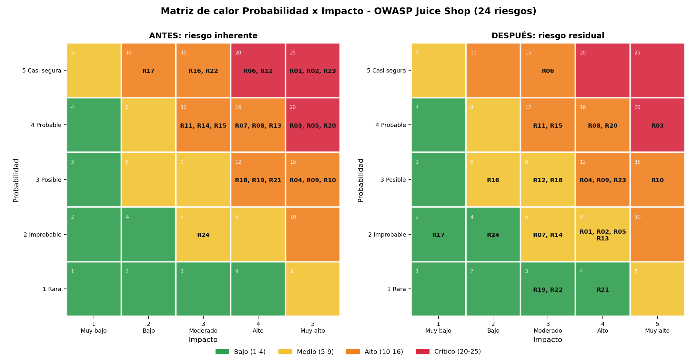

# Fase 6 – Tratamiento formal del riesgo (ISO/IEC 27005)

> **Documento generado** por `docs/fase-6/datos/generar_md.py` desde `riesgos-calculados.json`, que a su vez
> produce `riesgo.py` a partir de `riesgos.json`. No editar las tablas a mano: cambiar los datos y regenerar (`make risk`).

## 1. Método (reproducible)
- **Escala:** Probabilidad (P) e Impacto (I) de 1 a 5; nivel = P × I → **Bajo 1-4 · Medio 5-9 · Alto 10-16 · Crítico 20-25**.
- **Inherente:** para las amenazas de la Fase 1, P = ⌈media(R, E, Di)/2⌉ e I = ⌈media(D, A)/2⌉ sobre el DREAD de
  `docs/fase-1/fase1-modelado-amenazas.md` §5. Los riesgos sin DREAD (cloud, cumplimiento, operativos y el hallazgo del
  RASP) usan una **valoración cualitativa** del equipo y se marcan como tal.
- **Residual** (solo cuentan controles **verificados con evidencia**):
  - Eliminación o evitación implementada y verificada con evidencia: P = 1.
  - Si no: controles preventivos verificados n=1 -> P-2; n>=2 -> P-3 (mínimo 1).
  - Detección/alerta verificada para el riesgo -> I-1; contención verificada (runtime endurecido) -> I-1 (mínimo 1).
  - Controles diseñados (diff validado) o propuestos NO reducen el residual: se reportan como plan.

## 2. Opciones de tratamiento
| Decisión | Significado en este proyecto |
|---|---|
| **Mitigar** | Reducir probabilidad o impacto con controles (ISO/IEC 27005: *modificar*). |
| **Eliminar** | Suprimir la causa raíz del riesgo (corrección del código o de la configuración). |
| **Evitar** | Dejar de realizar la actividad o retirar la funcionalidad que origina el riesgo. |
| **Transferir** | Compartir el riesgo con un tercero (proveedor gestionado, póliza, contrato). |
| **Aceptar** | Retener el riesgo de forma consciente, documentada y temporal (ISO/IEC 27005: *retener*). |

## 3. Registro de riesgos: categorización por tipo e impacto
| ID | Riesgo | Origen | Tipo | Impactos (principal primero) | OWASP 2025 | CWE |
|---|---|---|---|---|---|---|
| R01 | Inyección SQL en el login (bypass de autenticación) | T01 / A1 | Seguridad | Reputacional, Legal, Financiero | A05:2025 | CWE-89 |
| R02 | Inyección SQL UNION en búsqueda (extracción de tablas) | T02 / A2-A3 | Seguridad | Legal, Reputacional, Financiero | A05:2025 | CWE-89 |
| R03 | Clave privada JWT embebida en el código (forja de tokens) | T03 | Seguridad | Reputacional, Legal, Financiero | A04:2025 | CWE-798/321 |
| R04 | Bibliotecas JWT obsoletas (algoritmos débiles) | T04 | Software | Reputacional, Financiero | A03:2025 | CWE-347 |
| R05 | Contraseñas con MD5 sin sal | T05 | Seguridad | Legal, Reputacional | A04:2025 | CWE-916 |
| R06 | BOLA/IDOR: lectura de recursos de otro usuario | T06 / A12 | Seguridad | Legal, Reputacional | A01:2025 (API1:2023) | CWE-639 |
| R07 | Asignación masiva de role=admin en el registro | T07 / A7 | Seguridad | Reputacional, Financiero | A01:2025 | CWE-915 |
| R08 | Inyección NoSQL en reseñas (MarsDB) | T08 | Seguridad | Reputacional, Operacional | A05:2025 | CWE-943 |
| R09 | Ejecución de código via eval()/vm | T09 | Seguridad | Operacional, Reputacional, Financiero | A05:2025 | CWE-95 |
| R10 | XXE en la carga de XML | T10 | Seguridad | Legal, Operacional | A02:2025 | CWE-611 |
| R11 | SSRF en la imagen de perfil por URL | T11 | Seguridad | Operacional, Legal | A01:2025 | CWE-918 |
| R12 | Listado de directorios y archivos internos (/ftp, /encryptionkeys) | T12 / A4-A5 | Seguridad | Reputacional, Legal | A02:2025 | CWE-548/538 |
| R13 | XSS (CSP debil, sin codificación de salida) | T13 | Seguridad | Reputacional, Legal | A05:2025 | CWE-79 |
| R14 | CORS permisivo (ACAO *) | T14 / A8 | Seguridad | Reputacional | A02:2025 | CWE-942 |
| R15 | Redirección abierta (lista blanca evadible) | T15 | Seguridad | Reputacional | A01:2025 | CWE-601 |
| R16 | Fuerza bruta en el login (sin limitación de intentos) | T16 / A10 | Seguridad | Reputacional, Operacional | A07:2025 | CWE-307 |
| R17 | /metrics expuesto sin autenticación | T17 / A6 | Seguridad | Reputacional | A02:2025 | CWE-200 |
| R18 | Denegación de servicio por vm/ZIP (agotamiento de recursos) | T18 | Técnico | Operacional, Financiero | A10:2025 | CWE-400 |
| R19 | Registro sin centralización ni alertas | T19 | Operacional | Operacional, Legal | A09:2025 | CWE-778 |
| R20 | Dependencias con CVE criticas (cadena de suministro) | T20 | Software | Financiero, Reputacional, Legal | A03:2025 | CWE-1395 |
| R21 | Configuración insegura al desplegar la arquitectura cloud (AWS) | Fase 2 | Cloud | Financiero, Operacional, Legal | A02:2025 | CWE-16 |
| R22 | RASP en modo bloqueo provoca la caída del proceso (auto-DoS) | Hallazgo Fase 6 | Técnico | Operacional, Reputacional | A10:2025 | CWE-248/755 |
| R23 | Exposición de datos personales (incumplimiento de protección de datos) | R01, R02, R06 | Cumplimiento | Legal, Reputacional, Financiero | A01/A05:2025 | CWE-200 |
| R24 | SIEM de un solo nodo (sin alta disponibilidad; agente con acceso al socket de Docker) | Riesgo introducido por la Fase 6 | Operacional | Operacional | A09:2025 | CWE-250 |

**Por tipo:** Seguridad: 16 · Software: 2 · Técnico: 2 · Operacional: 2 · Cloud: 1 · Cumplimiento: 1.
**Por impacto (riesgos que lo incluyen):** Reputacional: 18 · Legal: 13 · Financiero: 10 · Operacional: 10.

## 4. Matriz de decisiones por riesgo
| ID | Inherente (P×I) | Decisión | Secundaria | Residual (P×I) | Observación |
|---|---|---|---|---|---|
| R01 | 5×5=25 **Crítico** | **Mitigar** | Eliminar | 2×4=8 **Medio** |  |
| R02 | 5×5=25 **Crítico** | **Mitigar** | Eliminar | 2×4=8 **Medio** |  |
| R03 | 4×5=20 **Crítico** | **Eliminar** | Transferir | 4×5=20 **Crítico** | Ningún control desplegado detecta un JWT forjado: el residual se mantiene hasta desplegar el parche 04. |
| R04 | 3×5=15 **Alto** | **Aceptar** | Eliminar | 3×4=12 **Alto** | Aceptación TEMPORAL solo en el laboratorio (actualizar rompe retos de Juice Shop); en producción la decision es Eliminar. |
| R05 | 4×5=20 **Crítico** | **Eliminar** | Mitigar | 2×4=8 **Medio** |  |
| R06 | 5×4=20 **Crítico** | **Eliminar** | Mitigar | 5×3=15 **Alto** |  |
| R07 | 4×4=16 **Alto** | **Mitigar** | Eliminar | 2×3=6 **Medio** |  |
| R08 | 4×4=16 **Alto** | **Eliminar** | — | 4×4=16 **Alto** | El RASP solo cubre NoSQL de MongoDB (no MarsDB) y el CRS no se verifico en esta ruta: brecha documentada. |
| R09 | 3×5=15 **Alto** | **Eliminar** | Mitigar | 3×4=12 **Alto** |  |
| R10 | 3×5=15 **Alto** | **Eliminar** | — | 3×5=15 **Alto** |  |
| R11 | 4×3=12 **Alto** | **Mitigar** | Eliminar | 4×3=12 **Alto** | El RASP instrumenta node:http (protección SSRF) pero no se verifico en esta ruta; no reduce el residual. |
| R12 | 5×4=20 **Crítico** | **Evitar** | Mitigar | 3×3=9 **Medio** |  |
| R13 | 4×4=16 **Alto** | **Mitigar** | Eliminar | 2×4=8 **Medio** |  |
| R14 | 4×3=12 **Alto** | **Mitigar** | Eliminar | 2×3=6 **Medio** |  |
| R15 | 4×3=12 **Alto** | **Eliminar** | — | 4×3=12 **Alto** |  |
| R16 | 5×3=15 **Alto** | **Mitigar** | — | 3×2=6 **Medio** |  |
| R17 | 5×2=10 **Alto** | **Evitar** | Mitigar | 2×1=2 **Bajo** |  |
| R18 | 3×4=12 **Alto** | **Mitigar** | — | 3×3=9 **Medio** |  |
| R19 | 3×4=12 **Alto** | **Eliminar** | — | 1×3=3 **Bajo** |  |
| R20 | 4×5=20 **Crítico** | **Aceptar** | Eliminar | 4×4=16 **Alto** | Aceptación TEMPORAL solo en el laboratorio (la actualización rompe retos); en producción: Eliminar. |
| R21 | 3×4=12 **Alto** | **Evitar** | Transferir | 1×4=4 **Bajo** |  |
| R22 | 5×3=15 **Alto** | **Eliminar** | — | 1×3=3 **Bajo** | Inherente medido: el primer bloqueo termino el proceso (evidence/fase-6/rasp/02-bloqueo-caída-del-proceso/). Residual: la petición bloqueada no recibe respuesta; el resto del servicio sigue operativo. |
| R23 | 5×5=25 **Crítico** | **Mitigar** | Transferir | 3×4=12 **Alto** | La vía BOLA sigue abierta (R06): por eso el residual no baja más. |
| R24 | 2×3=6 **Medio** | **Aceptar** | — | 2×2=4 **Bajo** | Aceptado para el laboratorio; en producción: cluster gestionado y driver de logs en lugar del socket. |

**Decisiones principales:** Mitigar: 9 · Eliminar: 9 · Aceptar: 3 · Evitar: 3.
**Decisiones secundarias:** Eliminar: 8 · Mitigar: 5 · Transferir: 3. Las cinco opciones (Aceptar, Eliminar, Evitar, Mitigar, Transferir) se aplican; *Transferir* actúa como complemento en R03, R21 y R23.

## 5. Controles compensatorios por riesgo (con estado y evidencia)
### R01 — Inyección SQL en el login (bypass de autenticación)
| Control | Tipo | Estado | Evidencia |
|---|---|---|---|
| WAF ModSecurity + CRS 942xxx (bloqueo 403) | preventivo | Verificado | `evidence/fase-6/defensa-completa/` |
| RASP Aikido Zen: bloqueo en el sink sqlite3.all | preventivo | Verificado | `evidence/fase-6/rasp/03-bloqueo-sin-caída/` |
| Alerta SIEM WAF_InyeccionSQL_Bloqueada / RASP_Ataque_Detectado | detectivo | Verificado | `evidence/fase-6/siem/reglas-estado.json` |
| Parche 01: consulta parametrizada | eliminacion | Diseñado (diff validado) | `app-hardened/patches/01-sqli-login.patch` |

### R02 — Inyección SQL UNION en búsqueda (extracción de tablas)
| Control | Tipo | Estado | Evidencia |
|---|---|---|---|
| WAF ModSecurity + CRS 942xxx (bloqueo 403) | preventivo | Verificado | `evidence/fase-6/defensa-completa/` |
| RASP Aikido Zen: bloqueo en el sink sqlite3.all (query.q) | preventivo | Verificado | `evidence/fase-6/rasp/03-bloqueo-sin-caída/` |
| Alerta SIEM WAF_InyeccionSQL_Bloqueada / RASP_Ataque_Detectado | detectivo | Verificado | `evidence/fase-6/siem/reglas-estado.json` |
| Parche 02: consulta parametrizada | eliminacion | Diseñado (diff validado) | `app-hardened/patches/02-sqli-search.patch` |

### R03 — Clave privada JWT embebida en el código (forja de tokens)
| Control | Tipo | Estado | Evidencia |
|---|---|---|---|
| Parche 04: clave fuera del código (variable/secreto) | eliminacion | Diseñado (diff validado) | `app-hardened/patches/04-clave-privada-embebida.patch` |
| Gestor de secretos / KMS en la arquitectura cloud (Fase 2) | eliminacion | Propuesto | `infra/terraform/` |

### R04 — Bibliotecas JWT obsoletas (algoritmos débiles)
| Control | Tipo | Estado | Evidencia |
|---|---|---|---|
| SCA en CI (npm audit, OSV, Grype) que alerta del componente | detectivo | Verificado | `evidence/fase-3/sca/` |
| Actualizar jsonwebtoken/express-jwt y fijar algorithms RS256 | eliminacion | Propuesto | `docs/fase-1/fase1-modelado-amenazas.md` |

### R05 — Contraseñas con MD5 sin sal
| Control | Tipo | Estado | Evidencia |
|---|---|---|---|
| Bloqueo de la vía principal de extracción de hashes (SQLi: WAF + RASP) | preventivo | Verificado | `evidence/fase-6/defensa-completa/` |
| Alerta SIEM de inyeccion SQL | detectivo | Verificado | `evidence/fase-6/siem/reglas-estado.json` |
| Parche 03: bcrypt (factor 12) | eliminacion | Diseñado (diff validado) | `app-hardened/patches/03-md5-a-bcrypt.patch` |

### R06 — BOLA/IDOR: lectura de recursos de otro usuario
| Control | Tipo | Estado | Evidencia |
|---|---|---|---|
| WAF: NO lo bloquea (A12 VULNERABLE a través del WAF) | preventivo | NO efectivo (verificado) | `evidence/fase-6/defensa-completa/bola/` |
| Monitoreo de API: alerta API_Enumeracion_Objetos_PosibleBOLA | detectivo | Verificado | `evidence/fase-6/siem/reglas-estado.json` |
| Parche 08: verificación de propietario (403) | eliminacion | Diseñado (diff validado) | `app-hardened/patches/08-bola-cesta-propietario.patch` |

### R07 — Asignación masiva de role=admin en el registro
| Control | Tipo | Estado | Evidencia |
|---|---|---|---|
| Parche virtual ModSecurity 100001 | preventivo | Verificado | `evidence/fase-6/defensa-completa/` |
| Alerta SIEM WAF_ParcheVirtual_Activado | detectivo | Verificado | `evidence/fase-6/siem/reglas-estado.json` |
| Parche 06: lista blanca de campos | eliminacion | Diseñado (diff validado) | `app-hardened/patches/06-asignacion-masiva-registro.patch` |

### R08 — Inyección NoSQL en reseñas (MarsDB)
| Control | Tipo | Estado | Evidencia |
|---|---|---|---|
| Rechazar operadores ($ne, $where...) en filtros | eliminacion | Propuesto | `docs/fase-1/fase1-modelado-amenazas.md` |

### R09 — Ejecución de código via eval()/vm
| Control | Tipo | Estado | Evidencia |
|---|---|---|---|
| Contención: FS solo lectura, cap_drop ALL, no root, no-new-privileges | contencion | Verificado | `evidence/fase-5/despues/runtime-hardening-inspect.txt` |
| Parche 05: eliminar eval() | eliminacion | Diseñado (diff validado) | `app-hardened/patches/05-eval-userprofile.patch` |

### R10 — XXE en la carga de XML
| Control | Tipo | Estado | Evidencia |
|---|---|---|---|
| Parser XML sin entidades externas ni DTD | eliminacion | Propuesto | `app-hardened/patches/README.md` |

### R11 — SSRF en la imagen de perfil por URL
| Control | Tipo | Estado | Evidencia |
|---|---|---|---|
| Lista blanca de destinos y filtrado de egreso | preventivo | Propuesto | `app-hardened/patches/README.md` |

### R12 — Listado de directorios y archivos internos (/ftp, /encryptionkeys)
| Control | Tipo | Estado | Evidencia |
|---|---|---|---|
| nginx deny de rutas sensibles (403) | preventivo | Verificado | `evidence/fase-6/defensa-completa/` |
| Alerta SIEM Acceso_Rutas_Sensibles_Denegado | detectivo | Verificado | `evidence/fase-6/siem/reglas-estado.json` |
| Retirar serve-index y archivos internos del servidor web | eliminacion | Propuesto | `app-hardened/patches/README.md` |

### R13 — XSS (CSP debil, sin codificación de salida)
| Control | Tipo | Estado | Evidencia |
|---|---|---|---|
| CSP estricta (script-src 'self') y cabeceras en el WAF | preventivo | Verificado | `evidence/fase-6/defensa-completa/a9-security-headers.txt` |
| Codificación de salida en el frontend | eliminacion | Propuesto | `docs/fase-1/fase1-modelado-amenazas.md` |

### R14 — CORS permisivo (ACAO *)
| Control | Tipo | Estado | Evidencia |
|---|---|---|---|
| WAF oculta Access-Control-Allow-Origin | preventivo | Verificado | `evidence/fase-6/defensa-completa/a8-cors-headers.txt` |
| Parche 07: origen explicito | eliminacion | Diseñado (diff validado) | `app-hardened/patches/07-cors-restringido.patch` |

### R15 — Redirección abierta (lista blanca evadible)
| Control | Tipo | Estado | Evidencia |
|---|---|---|---|
| Comparación exacta de destinos permitidos | eliminacion | Propuesto | `docs/fase-1/fase1-modelado-amenazas.md` |

### R16 — Fuerza bruta en el login (sin limitación de intentos)
| Control | Tipo | Estado | Evidencia |
|---|---|---|---|
| Rate limiting nginx 5/min (HTTP 429) | preventivo | Verificado | `evidence/fase-6/defensa-completa/a10-bruteforce-login.txt` |
| Alerta SIEM Login_FuerzaBruta_RateLimit | detectivo | Verificado | `evidence/fase-6/siem/reglas-estado.json` |

### R17 — /metrics expuesto sin autenticación
| Control | Tipo | Estado | Evidencia |
|---|---|---|---|
| nginx deny /metrics (403) | preventivo | Verificado | `evidence/fase-6/defensa-completa/a6-metrics.txt` |
| Parche virtual ModSecurity 100002 | preventivo | Verificado | `evidence/fase-6/siem/consultas-logql.jsonl` |
| Alerta SIEM Acceso_Rutas_Sensibles_Denegado | detectivo | Verificado | `evidence/fase-6/siem/reglas-estado.json` |

### R18 — Denegación de servicio por vm/ZIP (agotamiento de recursos)
| Control | Tipo | Estado | Evidencia |
|---|---|---|---|
| Límites de pids (200), memoria (1 GiB) y CPU (1.0) | contencion | Verificado | `evidence/fase-5/despues/runtime-hardening-inspect.txt` |

### R19 — Registro sin centralización ni alertas
| Control | Tipo | Estado | Evidencia |
|---|---|---|---|
| SIEM: Alloy -> Loki -> Grafana con 7 reglas de correlación | eliminacion | Verificado | `evidence/fase-6/siem/` |
| Alertas activas verificadas (6/7 en firing durante las pruebas) | detectivo | Verificado | `evidence/fase-6/siem/reglas-estado.json` |

### R20 — Dependencias con CVE criticas (cadena de suministro)
| Control | Tipo | Estado | Evidencia |
|---|---|---|---|
| SCA en CI (npm audit, OSV, Grype, Trivy) en cada push | detectivo | Verificado | `evidence/fase-3/sca/` |
| Actualizar dependencias (crypto-js, lodash, marsdb...) | eliminacion | Propuesto | `docs/fase-5/fase5-contenedores-hardening.md` |

### R21 — Configuración insegura al desplegar la arquitectura cloud (AWS)
| Control | Tipo | Estado | Evidencia |
|---|---|---|---|
| Checkov sobre Terraform (144 passed / 0 failed) | preventivo | Verificado | `evidence/fase-2/checkov-final/` |
| No desplegar sin aprobación de costos (sin terraform apply) | evitacion | Verificado | `docs/AUDITORIA_FINAL_FASES_4_5.md` |
| Servicios gestionados (AWS WAFv2, KMS) y responsabilidad compartida | transferencia | Propuesto | `infra/terraform/` |

### R22 — RASP en modo bloqueo provoca la caída del proceso (auto-DoS)
| Control | Tipo | Estado | Evidencia |
|---|---|---|---|
| Node --unhandled-rejections=warn (proceso sin caídas, RestartCount 0) | eliminacion | Verificado | `evidence/fase-6/rasp/03-bloqueo-sin-caída/rasp-bloqueos.log` |

### R23 — Exposición de datos personales (incumplimiento de protección de datos)
| Control | Tipo | Estado | Evidencia |
|---|---|---|---|
| Bloqueo de la extracción masiva por SQLi (WAF + RASP) | preventivo | Verificado | `evidence/fase-6/defensa-completa/` |
| Detección SIEM (SQLi, enumeracion BOLA) | detectivo | Verificado | `evidence/fase-6/siem/reglas-estado.json` |
| Póliza de ciberriesgo / cláusulas contractuales | transferencia | Propuesto | `docs/fase-6/tratamiento-riesgo.md` |

### R24 — SIEM de un solo nodo (sin alta disponibilidad; agente con acceso al socket de Docker)
| Control | Tipo | Estado | Evidencia |
|---|---|---|---|
| Solo 127.0.0.1, socket de solo lectura, retención 30 dias, sin telemetría externa | contencion | Verificado | `deploy/hardened/docker-compose.ops.yml` |

## 6. Matriz de calor (Probabilidad × Impacto)

| Nivel | Inherente | Residual |
|---|---|---|
| Bajo | 0 | 5 |
| Medio | 1 | 9 |
| Alto | 15 | 9 |
| Crítico | 8 | 1 |

Archivos: `img/heatmap-antes.png`, `img/heatmap-despues.png`, `img/heatmap-comparativo.png`, `img/niveles-antes-despues.png`.

## 7. Lectura honesta del residual
- Quedan **10 riesgos Alto/Crítico**: R03 (Crítico), R04 (Alto), R06 (Alto), R08 (Alto), R09 (Alto), R10 (Alto), R11 (Alto), R15 (Alto), R20 (Alto), R23 (Alto).
  Su tratamiento definitivo (parches de código, actualización de dependencias, parser XML, lista blanca SSRF) está
  **diseñado o propuesto, no desplegado**, por lo que el método no les concede reducción.
- **R03** (clave privada JWT embebida) sigue **Crítico**: ningún control desplegado detecta un token forjado; requiere
  desplegar el parche 04 con un gestor de secretos.
- **R06** (BOLA) baja solo en impacto: el WAF **no** lo bloquea (verificado, `evidence/fase-6/defensa-completa/bola/`);
  el SIEM lo **detecta** (`API_Enumeracion_Objetos_PosibleBOLA`) y el parche 08 lo eliminaría en código.
- Las aceptaciones (R04, R20, R24) son **temporales y limitadas al laboratorio**, con su condición de revisión.
